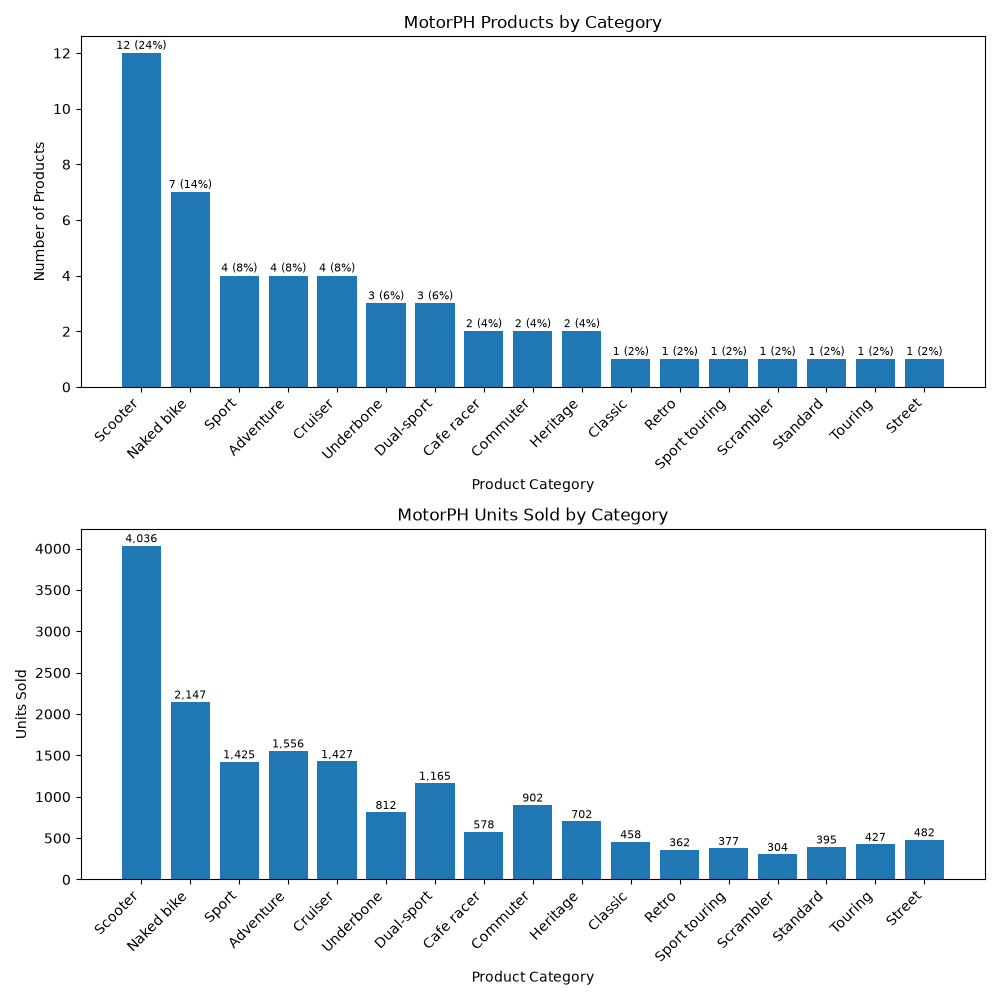

# MotorPH Category Distribution Chart

Milestone 2 Draft: "MO-IT106 Data Analytics Fundamentals"

## The chart

## Chart type

I used a bar chart because it is the easiest way to compare the categories with each other. Each bar is one product category, and the taller the bar, the more products it has. The label on each bar shows the count and its share out of 50 products, for example 12 (24%).

## What the numbers show

| Product Category | Products | Share |
|---|---|---|
| Scooter | 12 | 24% |
| Naked bike | 7 | 14% |
| Sport | 4 | 8% |
| Adventure | 4 | 8% |
| Cruiser | 4 | 8% |
| Underbone | 3 | 6% |
| Dual-sport | 3 | 6% |
| Cafe racer | 2 | 4% |
| Commuter | 2 | 4% |
| Heritage | 2 | 4% |
| Classic | 1 | 2% |
| Retro | 1 | 2% |
| Sport touring | 1 | 2% |
| Scrambler | 1 | 2% |
| Standard | 1 | 2% |
| Touring | 1 | 2% |
| Street | 1 | 2% |
| **Total** | **50** | **100%** |

## Key insights

Scooter is the biggest group with 12 out of 50 (24%), followed by Naked bike with 7 (14%). Sport, Adventure, and Cruiser have 4 each (8%), therefore the top five groups alone already hold 31 of the 50 products. This means most of the list is everyday types, while the rest are specialty bikes with only 1 or 2 each.

As a result, MotorPH should restock scooters and naked bikes first since they are the bulk of the lineup. For the Week 8 dashboard, I will add the sales data to check if these same types are also the ones selling the most.

## Source

Chart generated by `MotorPH_Category_Chart.py` from the cleaned Milestone 1 dataset (`MotorPH_Product_List_Cleaned.csv`).
